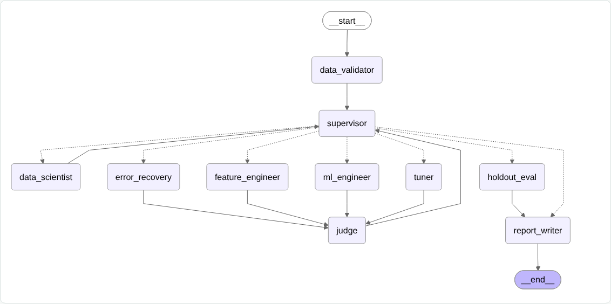
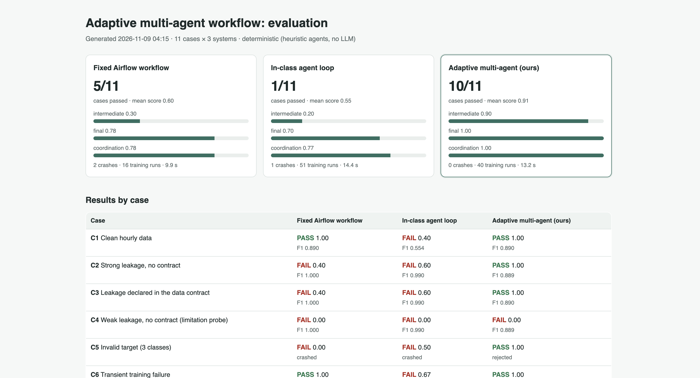

# Citi Bike hourly demand: Airflow pipeline + agent-based ML

Jersey City Citi Bike trips and hourly weather are ingested, cleaned and merged by an **Airflow 3.4** DAG and loaded into **PostgreSQL**, then analyzed (Part 1). The cleaned table is handed to the in-class **LangGraph** agent workflow, adapted to train and evaluate a classifier for busy hours (Part 2). Part 3 (bonus) adds an adaptive multi-agent system with an evaluation suite.

## Where to look

| Part | What I built or changed | Main files |
|---|---|---|
| 1 | Airflow DAG: ingestion → parallel cleaning → merge → Postgres → analysis + hand-off | `dags/citibike_weather_pipeline.py`, `dags/citibike/*.py`, `tests/` |
| 1 | Containerized setup | `Dockerfile`, `docker-compose.yaml`, `.devcontainer/`, `Makefile` |
| 2 | Changes to the in-class agent loop (two new agents, guardrail, time split) | [`agent-lab/CHANGES.md`](agent-lab/CHANGES.md) lists every file |
| 3 | Adaptive multi-agent system, baselines, evaluation suite, dashboard | [`agent-lab/adaptive/`](agent-lab/adaptive/README.md) |

Everything else in `agent-lab/` is the unmodified class template ([Kedar-V/automl-research-lab](https://github.com/Kedar-V/automl-research-lab)), kept because the agent UI and gateway depend on it.

## How to run

Requirements: Docker Desktop (≥ 6 GB memory), `make`; Node.js 20+ for the Part 2 UI.

```bash
make up                 # Part 1: build + start Airflow → http://localhost:8080 (airflow / airflow)
make trigger            # unpause + trigger the DAG (or ▶ in the UI)
make down               # stop Airflow before Part 2 to free memory

make agents             # Part 2: agent UI → http://127.0.0.1:5173/solution-loop
                        #   dataset citibike_hourly_latest.csv, target high_demand, budget 5 → Run loop
make agents-down

make part3-eval         # Part 3: evaluation suite → agent-lab/adaptive/eval/out/dashboard.html
make results            # copy results to docs/results/ and write them into this README

make test               # Part 1 unit tests (in the Airflow container)
make test-agents        # Part 2 + 3 unit tests (in a Python 3.12 container)
```

`make sample-data` writes synthetic raw files in the real formats to `data/raw/`. The DAG treats existing files as a cache, so it can run offline. The cleaned data can be queried with `psql -h localhost -p 5433 -U pipeline citibike` (password `pipeline`).

## Part 1: Airflow pipeline

**Data.**

| Dataset | Source | Grain |
|---|---|---|
| Citi Bike trips, Jersey City / Hoboken | `s3.amazonaws.com/tripdata/JC-YYYYMM-citibike-tripdata.csv.zip` | one row per ride |
| Hourly weather (temperature, precipitation, wind, humidity) | Open-Meteo historical archive API | one row per hour |

The two are joined on the hour. The Jersey City files use the NYC schema at a few MB per month.

**DAG** (`citibike_weather_pipeline`):

```
plan_months
   ├── trips   [TaskGroup]  extract_trips × N months (mapped) → clean_trips
   └── weather [TaskGroup]  extract_weather × N months (mapped) → clean_weather
merge → load_to_postgres
   └── analysis [TaskGroup]  make_plots ∥ train_model ∥ publish_for_agents
```

- **Scheduling.** `@monthly`, because Citi Bike publishes monthly files. A scheduled run processes the 6 most recent published months, ending 2 months before the run date. A manual run can pass `months` instead. `catchup=False`, `max_active_runs=1`, 2 retries per task.
- **Parallelism.** The trips and weather branches are independent and run at the same time. Inside each branch, every month's download is its own mapped task, up to 4 at a time. The three analysis tasks also run in parallel. The executor is LocalExecutor with parallelism 8.
- **Reliability.**
  - Raw files are cached and written atomically.
  - The load replaces the hours it inserts, so re-running a month doesn't duplicate it.
  - Tasks pass Parquet file paths through XCom, not DataFrames.
  - The analysis tasks read back only the current run's months.

**Transformations.**
- **Trips:** drop rows missing required fields and duplicate `ride_id`s; parse mixed timestamp formats; keep rides of 1–240 minutes inside the requested months; aggregate to hourly trips, member share, e-bike share and average duration. Hours with no rides are kept as 0. Each step's dropped-row count goes to `trips_quality.json`.
- **Weather:** coerce to numbers; treat impossible values as missing; drop duplicate hours (daylight-saving change); interpolate gaps of **at most 3 consecutive hours** and drop longer ones.
- **Merge:** one-to-one join on the hour, plus calendar features (hour, day of week, weekend, US federal holiday, raining).

**Analysis.** A seasonal baseline (mean of the same day-of-week × hour) and two random forests with identical settings: one on time features only, one on time + weather. The split is chronological (last 20% of hours = test). Comparing the two forests shows how much weather adds by itself.

<!-- results:part1 -->
Train: 2026-04-01 to 2026-08-25 (3,513 hours) · test: 2026-08-25 to 2026-09-30 (879 hours) · scikit-learn 1.9.1

| Model | MAE (trips/hour) | RMSE | R² |
|---|---|---|---|
| Seasonal baseline: mean of the same day-of-week × hour | 33.1 | 50.3 | 0.815 |
| Random forest, time features only | 32.5 | 49.4 | 0.822 |
| Random forest, time + weather features | 27.5 | 40.9 | 0.878 |

The two random forests have the same settings and differ only in their inputs. Adding weather changes R² from 0.822 to 0.878 and MAE from 32.5 to 27.5 trips/hour; that difference is what weather contributes.

Top feature importances (time + weather forest): `hour_of_day` 0.73, `day_of_week` 0.08, `temp_c` 0.07, `humidity_pct` 0.04.


Raw numbers: [`docs/results/part1-metrics.json`](docs/results/part1-metrics.json)
<!-- /results:part1 -->

**Observations.**
- **Weekly rhythm.** Weekdays show two commute peaks (morning and late afternoon); weekends a single midday plateau. This is why the time-only models already score well.
- **Rain.** Rainy hours sit below dry hours at the same temperature, and the largest drops in daily trips coincide with the wettest days.
- **Scope.** The weather inputs are *observed* weather for each hour. These results measure demand given known conditions. Predicting demand ahead of time would need weather *forecasts* as inputs, which would likely lower accuracy.

## Part 2: agent workflow

**Task.** `publish_for_agents` writes `agent-lab/datasets/citibike_hourly_latest.csv` and a data contract.
- **Label:** `high_demand` = 1 when an hour's trips reach the 75th percentile of the **first 60% of hours**. That is the agents' training segment; the remaining 20% validation and 20% holdout hours use the same fixed threshold.
- **Contract:** names the time column and four leakage columns (`trips`, `member_share`, `ebike_share`, `avg_duration_min`), which are computed from the same rides as the label.

**Changes to the in-class loop** (details and file list in [`agent-lab/CHANGES.md`](agent-lab/CHANGES.md)):
- **Data Validator (new, first):** reads the contract. Checks for a binary target, enough rows, missing values and duplicate hours. Flags leakage: the contract's columns, plus any column that alone separates the classes. That check is computed on the training segment only.
- **ML Engineer:** always drops the validator's columns, whatever the LLM or heuristic proposes. Splits chronologically when there is a time column.
- **Fallback search strategy:** baseline, then each model family once, then tune the best family. The original repeated logistic regression.
- **Report Writer (new, last):** confusion matrix, majority-class baseline, feature importances and experiment history. All of it comes from the single holdout fit.
- **Live agent graph:** shows both new agents and the validator's `ok` / `invalid` routes.

<!-- results:part2 -->
Dataset: `citibike_hourly_latest.csv`, label `high_demand` = trips >= 198; threshold basis: 75% quantile of trips in the first 60% of hours (up to 2026-07-19 18:00); later hours use the same fixed threshold. Split: chronological; the holdout is the last 879 hours. scikit-learn 1.9.1. Agents ran their heuristic fallbacks (no LLM key).

| Cycle | Model (hyperparameters) | Validation F1 | Judge |
|---|---|---|---|
| 1 | logistic_regression `{"C": 0.25, "max_iter": 1000}` | 0.588 | revise |
| 2 | random_forest `{"n_estimators": 150, "max_depth": 6}` | 0.772 | revise |
| 3 | hist_gradient_boosting `{"learning_rate": 0.1, "max_iter": 100}` | 0.889 | accept |

Holdout result for the selected model (hist_gradient_boosting):

| | F1 | Accuracy | Precision | Recall |
|---|---|---|---|---|
| hist_gradient_boosting | 0.863 | 0.918 | 0.879 | 0.846 |
| Always predict "not busy" | 0.000 | 0.696 | — | 0.000 |

Confusion matrix (rows = actual, columns = predicted): normal → 581 normal / 31 busy; busy → 41 normal / 226 busy.

Features used: `temp_c`, `precip_mm`, `wind_kmh`, `humidity_pct`, `hour_of_day`, `day_of_week`, `month`, `is_weekend`, `is_holiday`, `is_raining`. The four leakage columns from the contract and the time key were dropped.

Full report: [`docs/results/part2-agent-report.json`](docs/results/part2-agent-report.json)
<!-- /results:part2 -->

Accuracy should be read against the always-"not busy" row: that trivial rule's accuracy is just the share of normal hours in the holdout. F1 on the busy class combines precision and recall for the hours that matter. Gradient boosting has no built-in feature importances, so none are reported when it is selected.

## Part 3 (bonus): adaptive multi-agent system

A Supervisor chooses the next agent after every step, based on the intermediate results:
- **ML Engineer** — new model family
- **Tuner** — more capacity for the best family
- **Feature Engineer** — new derived features
- **Error Recovery** — retry, then repair hyperparameters, then block a failing family

An 11-case evaluation suite scores it at three levels (intermediate, final, coordination) against the fixed Airflow workflow and the unmodified in-class loop. Every case specifies its input, expected behaviour, scoring criteria and pass threshold.

<!-- results:part3 -->
Cases passed (of 11): Fixed Airflow workflow **5**, In-class agent loop **1**, Adaptive multi-agent (ours) **10**. On the real Citi Bike data (C10): Fixed Airflow workflow F1 1.000 (trained on trips, member_share, ebike_share, avg_duration_min); In-class agent loop F1 0.966 (trained on trips, member_share, ebike_share, avg_duration_min); Adaptive multi-agent (ours) F1 0.863 (no leakage columns).

Full tables: [`docs/results/part3-summary.md`](docs/results/part3-summary.md) · dashboard: [`agent-lab/adaptive/eval/out/dashboard.html`](agent-lab/adaptive/eval/out/dashboard.html)
<!-- /results:part3 -->

Design, case definitions, comparison and limitations: [`agent-lab/adaptive/README.md`](agent-lab/adaptive/README.md).

## Limitations

- Weather inputs are observed, not forecast (see Part 1).
- Agent results come from the deterministic heuristic agents (no LLM key), so they can be reproduced. The LLM path exists but is not part of the reported numbers.
- Leakage that is only weakly predictive can't be detected automatically. The data contract covers it (Part 3, case C4).
- Results depend on library versions; the scikit-learn version is recorded in each result file. Random forest and gradient boosting use fixed seeds.

## Screenshots

| | |
|---|---|
| Airflow run, Grid view |  |
| Airflow DAG, Graph view |  |
| Agent graph (Part 2) |  |
| Agent experiments and evaluation (Part 2) |  |
| Experiment timeline and holdout (Part 2) |  |
| Adaptive workflow graph (Part 3) |  |
| Evaluation dashboard (Part 3) |  |

## Repository layout

```
dags/citibike_weather_pipeline.py   DAG wiring
dags/citibike/                      extract, transform, load, analyze, publish
scripts/                            sample data generator, update_results.py
tests/                              Part 1 unit tests
docs/results/, docs/screenshots/    evidence (written by `make results`) and screenshots
agent-lab/                          class template + Part 2 changes (CHANGES.md)
agent-lab/adaptive/                 Part 3
```
