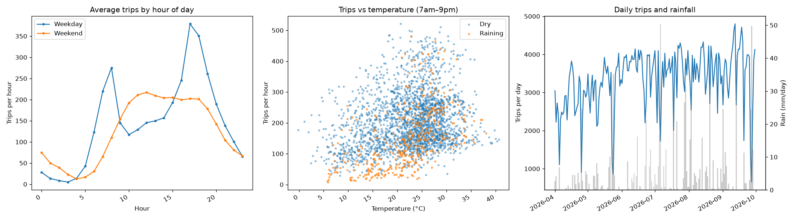
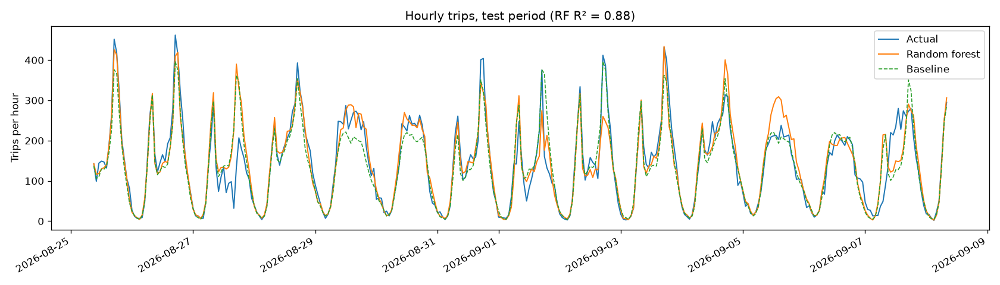
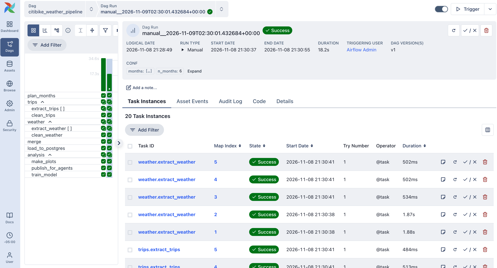
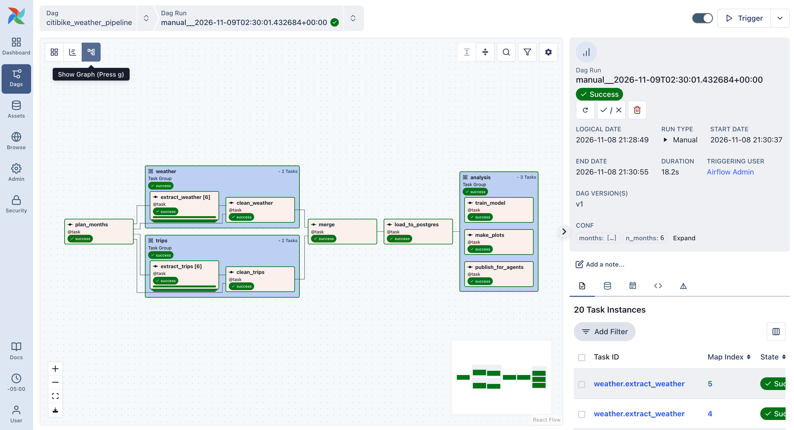
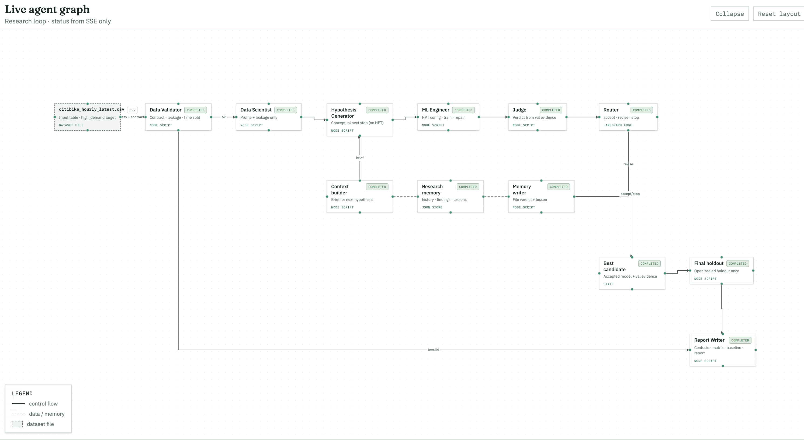
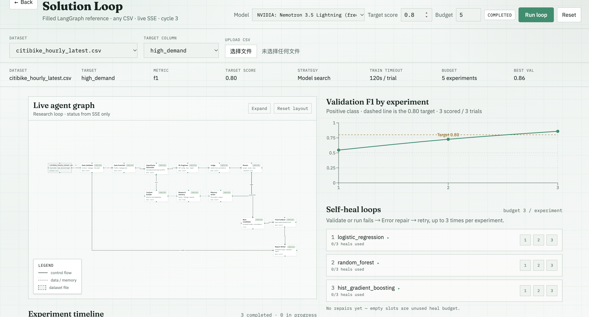
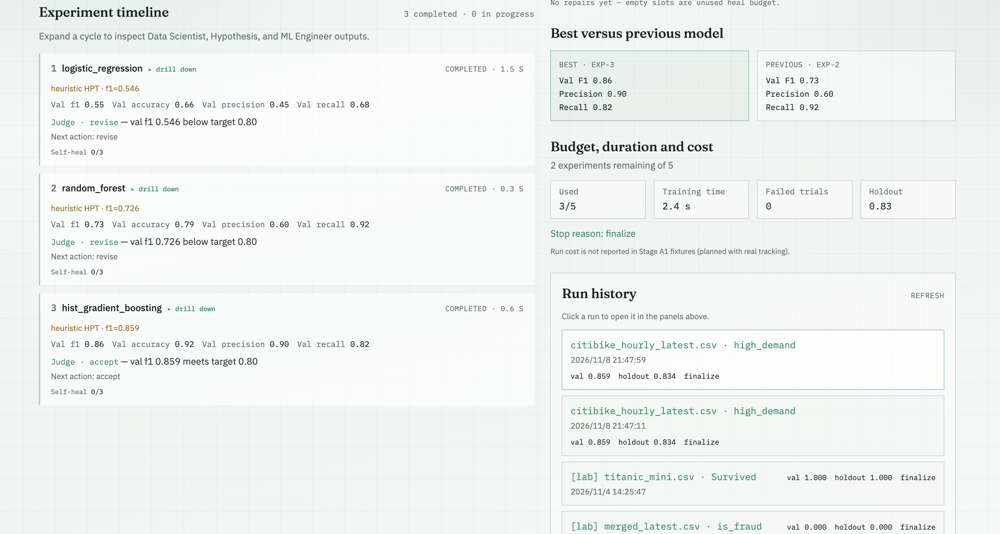

# Citi Bike demand pipeline: Airflow + agent-based ML

An end-to-end pipeline that ingests **Citi Bike trip records** and **hourly weather**, cleans and merges them in **Apache Airflow 3.4**, loads the result into **PostgreSQL**, then analyzes it: exploratory plots plus a model that forecasts hourly bike demand.

**Part 2** (`agent-lab/`) adapts the in-class LangGraph agent workflow to train and evaluate a model on the same cleaned data, which Airflow hands over as a CSV plus a data contract.

```
Part 1 (Airflow, :8080)                                   Part 2 (agent lab, :5173)
Citi Bike + weather → clean ∥ clean → merge → Postgres → publish_for_agents ──► agent-lab/datasets/
                                                   └→ plots ∥ model                 citibike_hourly_latest.csv
                                                                                    + .contract.json
```

## Quick start

Requirements: Docker Desktop (4 GB+ memory for Docker) and `make`.

```bash
make up          # build the image and start Airflow + two Postgres databases
                 # UI: http://localhost:8080   user: airflow   password: airflow
make trigger     # unpause the DAG and trigger a run (or click ▶ in the UI)
make test        # unit tests, run inside the container
make down        # stop (data is kept);  make clean  deletes everything
```

Part 2 runs as a separate stack (gateway + UI). It needs Node.js 20+ in addition to Docker.

```bash
make agents      # = cd agent-lab && make start-mac   → http://127.0.0.1:5173/solution-loop
make agents-down
```

Run Part 1 first, so `agent-lab/datasets/citibike_hourly_latest.csv` exists. Then, on `/solution-loop`, pick that dataset, set target `high_demand` and budget `5`, and click **Run loop**. Adding an `OPENROUTER_API_KEY` to `agent-lab/.env` (free key) lets the agents use an LLM. Without it they use deterministic heuristics, and the loop still runs end to end.

The cleaned data lives in the `pipeline-db` database, which is reachable from your machine:

```bash
psql -h localhost -p 5433 -U pipeline citibike      # password: pipeline
citibike=> SELECT hour, trips, temp_c, precip_mm FROM hourly_demand LIMIT 5;
```

Outputs (plots and metrics) are written to `data/output/`.

**Offline demo:** `make sample-data` writes synthetic raw files with the real formats to `data/raw/`. The extract tasks treat files that already exist as a cache, so the DAG then runs without downloading anything.

**Dev container:** opening the folder in VS Code → "Reopen in Container" uses `.devcontainer/devcontainer.json`. It starts the same stack and attaches to the `dev` service, with the repo mounted at `/workspace`.

## Data sources

| Dataset | Source | Grain | Join key |
|---|---|---|---|
| Citi Bike trips, Jersey City / Hoboken | `s3.amazonaws.com/tripdata/JC-YYYYMM-citibike-tripdata.csv.zip` (public monthly files) | one row per ride | ride start time → hour |
| Hourly weather (temperature, precipitation, wind, humidity) | Open-Meteo historical API (free, no key), at Jersey City's coordinates | one row per hour | hour |

The Jersey City system uses the same schema as NYC Citi Bike, but its monthly files are a few MB instead of ~1 GB, which keeps the pipeline fast on a laptop.

## Pipeline structure

```
plan_months
   ├── trips   (TaskGroup): extract_trips ×N months (parallel, mapped) → clean_trips
   └── weather (TaskGroup): extract_weather ×N months (parallel, mapped) → clean_weather
merge → load_to_postgres
   └── analysis (TaskGroup): make_plots ∥ train_model
```

- **Scheduling.** `schedule="@monthly"`, because Citi Bike publishes one file per month. Each scheduled run processes the 6 most recent *published* months, ending 2 months before the run date because of the publishing delay; a run on 2026-11-07 processes 2026-04 … 2026-09. `catchup=False` and `max_active_runs=1`. A manual run can set the `months` parameter (for example `["2026-08","2026-09"]`) in the trigger form. Tasks retry twice, one minute apart, which covers transient download failures.
- **Parallel processing.**
  1. The trips and weather branches have no dependency on each other, so they run at the same time.
  2. Inside each branch, the download for each month is a separate mapped task (`.expand(month=months)`); up to 4 per branch run at once.
  3. `make_plots` and `train_model` both depend only on the load, so they run in parallel too.
  
  The LocalExecutor runs up to 8 tasks at once (`AIRFLOW__CORE__PARALLELISM`).
- **Data passing.** Tasks pass file paths (Parquet) through XCom, never DataFrames.
- **Idempotent and cached.**
  - Raw files are cached in `data/raw/` and written atomically, so a re-run never downloads a file twice or sees a half-downloaded one.
  - The load deletes the hours it is about to insert, so re-running a month replaces it instead of duplicating it.

## Transformations

**Trips** (`clean_trips` → `trips_to_hourly`). Each step's row count is logged as a data-quality report (`data/processed/<window>/trips_quality.json`).

1. Drop rows missing `ride_id`, `started_at` or `ended_at`.
2. Drop duplicate `ride_id`s.
3. Parse timestamps (the files mix formats with and without milliseconds) and drop unparseable ones.
4. Keep rides of 1–240 minutes. Shorter ones are false starts or re-docks; longer ones are lost or unreturned bikes.
5. Drop rides that start outside the requested months.
6. Aggregate to one row per hour: `trips`, `member_share`, `ebike_share`, `avg_duration_min`. Hours with no rides are kept with `trips = 0`, so quiet hours aren't silently missing.

**Weather** (`clean_weather`):

1. Coerce values to numbers.
2. Set physically impossible values to missing.
3. Drop duplicate hours (these can appear at the daylight-saving switch).
4. Reindex to the full hourly range and fill gaps of up to 3 hours by interpolation; hours that still have gaps are dropped.

**Merge** (`merge_hourly`): a one-to-one join on the hour (validated), plus calendar features: `hour_of_day`, `day_of_week`, `is_weekend`, `is_holiday` (US federal holidays) and `is_raining` (precipitation > 0.1 mm). The result is the `hourly_demand` table.

## Analysis (Part 1)

Both analysis tasks **read the data back from Postgres**.

- `eda.png`: average trips by hour (weekday vs weekend), trips vs temperature (dry vs raining), daily trips vs rainfall.
- `publish_for_agents`: the Part 2 hand-off (see below). It runs in parallel with the other two.
- `train_model`: a `RandomForestRegressor` predicts trips per hour from time and weather features. It is compared with a seasonal baseline: the average for the same day-of-week and hour in the training data.
  - The split is **chronological** (last 20% of hours as the test set), so the model is never evaluated on hours earlier than the ones it trained on.
  - Metrics: MAE, RMSE and R², written to `data/output/metrics.json` and appended to the `model_metrics` table with the run id. Plot: `predictions.png`.

### Results

Data: 6 months of Jersey City trips (2026-04 to 2026-09), 4,392 hours. Training period: 2026-04-01 to 2026-08-25 (3,513 hours). Test period: 2026-08-25 to 2026-09-30 (879 hours).

| Model | MAE (trips/hour) | RMSE | R² |
|---|---|---|---|
| Seasonal baseline (average for the same day-of-week × hour) | 33.1 | 50.3 | 0.815 |
| Random forest (time + weather) | **27.5** | **40.9** | **0.878** |

The random forest cuts MAE by 17% and RMSE by 19% compared with the baseline. Top feature importances: `hour_of_day` 0.73, `day_of_week` 0.08, `temp_c` 0.07, `humidity_pct` 0.04.




**Key findings**

- **Demand is mostly a weekly rhythm.**
  - Weekdays have two commute peaks: about 275 trips/hour at 8am and about 380 at 5pm.
  - Weekends have one midday plateau of about 200 trips/hour.
  - This is why the time-only baseline already reaches R² = 0.82, and why `hour_of_day` dominates the importances.
- **Weather explains part of what the clock can't.** Adding it lifts R² from 0.82 to 0.88. Rainy hours sit clearly below dry hours at the same temperature, and the deepest drops in daily trips line up with the heaviest rain days.
- `is_raining` has a near-zero importance even though rain clearly matters. The model gets the same signal from `precip_mm` and `humidity_pct`, which carry more detail. Low importance here doesn't mean "no effect".
- **Remaining errors** are mostly weekend afternoons and a few unusually busy commute peaks. Events, holidays outside the federal calendar, and transit disruptions are not in the data.

## Part 2: agent-based ML workflow

`agent-lab/` is the in-class template ([Kedar-V/automl-research-lab](https://github.com/Kedar-V/automl-research-lab)) with a modified solution loop. **Full details: [`agent-lab/CHANGES.md`](agent-lab/CHANGES.md).**

**Task.** Classify each hour as `high_demand` (trips at or above the 75th percentile) from weather and calendar features. Metric: F1 on the busy class, plus accuracy, precision and recall.

**Agent modifications.**
- **Data Validator (new):** reads the data contract from Airflow, finds the time column, and flags leakage columns: `trips`, `member_share`, `ebike_share` and `avg_duration_min` are computed from the same rides as the label. It also flags any column that alone separates the classes. An invalid dataset skips straight to the report.
- **ML Engineer (modified):** a guardrail always drops the leakage columns, even if the LLM's spec keeps them. It splits **chronologically** (last 20% of hours = holdout), because a random split leaks neighbouring hours.
- **Heuristic strategy (modified):** baseline, then each model family once, then tune the best family. The original kept re-tuning logistic regression.
- **Report Writer (new):** confusion matrix, majority-class baseline, feature importances (when the model provides them) and the full experiment history, saved to `agent-lab/artifacts/loop_reports/`.
- **Live agent graph:** shows both new agents and the validator's `ok` / `invalid` routes.

### Part 2 results

Run settings: `citibike_hourly_latest.csv`, target `high_demand`, target score 0.80, budget 5. No LLM key was set, so the agents ran their heuristic fallbacks. Split: chronological. The holdout is the last 879 hours (Aug 25 – Sep 30), the same period as Part 1's test set.

| Cycle | Model family (hyperparameters) | Val F1 | Judge |
|---|---|---|---|
| 1 | logistic regression (C=0.25) | 0.546 | revise |
| 2 | random forest (150 trees, depth 6) | 0.726 | revise |
| 3 | hist gradient boosting (lr 0.1, 100 iters) | **0.859** | **accept** |

The loop stopped after 3 of the 5 budgeted experiments, because cycle 3 met the 0.80 target.

**Sealed holdout, best model (gradient boosting):**

| | F1 | Accuracy | Precision | Recall |
|---|---|---|---|---|
| Gradient boosting | **0.834** | **0.910** | 0.847 | 0.822 |
| Majority-class baseline ("never busy") | 0.000 | 0.725 | – | 0.000 |

Confusion matrix on the holdout (rows = actual, columns = predicted):

| | pred: normal | pred: busy |
|---|---|---|
| **actual: normal** | 601 | 36 |
| **actual: busy** | 43 | 199 |

**Findings**

- **Accuracy alone would be misleading.** Always predicting "not busy" already scores 72.5% accuracy with F1 = 0. The model's 91% accuracy only means something next to that baseline. F1 on the busy class (0.83) is the honest number.
- **Leakage was caught, not trusted away.** The published CSV deliberately keeps `trips`, `member_share`, `ebike_share` and `avg_duration_min`, and `trips` alone defines the label. The Data Validator flagged them, and the ML Engineer's guardrail dropped them from every experiment. The features actually used are weather and calendar columns only, so the 0.83 is a real forecasting score, not a lookup.
- **The holdout score is close to validation** (0.834 vs 0.859), even though the holdout is a later, cooler period (late Aug–Sep). The chronological split makes this a fair test.
- **Errors are balanced:** 36 false alarms and 43 missed busy hours. Missed busy hours cost more in practice (no bikes where people want them). Lowering the decision threshold would trade some precision for recall.
- **The modified search strategy mattered.** The original heuristic would have kept re-tuning logistic regression. That family is limited here because `hour_of_day` has a twin-peaked, non-linear effect.
- Gradient boosting exposes no `feature_importances_`, so the report's importance field is empty for this run. Part 1's random forest shows the same picture anyway: `hour_of_day` dominates, then day of week and temperature.

## Screenshots

| | |
|---|---|
| Airflow run, Grid view (all tasks green) |  |
| Airflow DAG, Graph view (parallel branches and TaskGroups) |  |
| Agent graph (Part 2) |  |
| Agent experiments and evaluation (Part 2) |  |
| Experiment timeline and holdout (Part 2) |  |

## Repository layout

```
dags/citibike_weather_pipeline.py   the DAG (wiring only)
dags/citibike/                      pipeline logic: config, extract, transform, load, analyze
scripts/make_sample_data.py         synthetic raw files for tests and offline runs
tests/                              pytest unit tests
Dockerfile, docker-compose.yaml     Airflow 3.4 (LocalExecutor) + Postgres ×2
.devcontainer/                      VS Code dev container
Makefile                            up / trigger / test / down / clean / agents
agent-lab/                          Part 2: in-class agent template + changes (see CHANGES.md)
```
