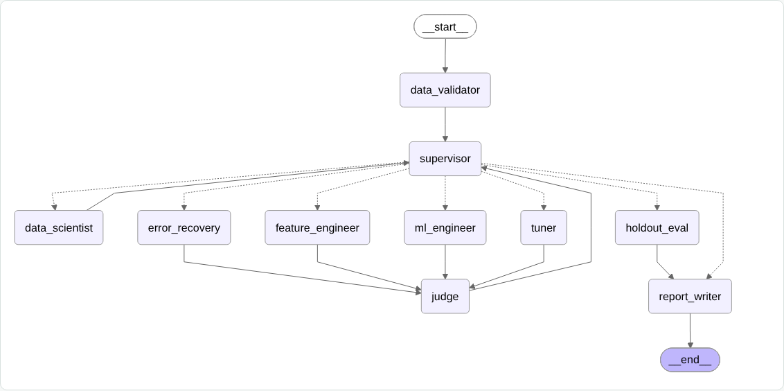

# Part 3 (bonus): adaptive multi-agent system + evaluation

An agent system where a **Supervisor** picks the next agent at run time from the intermediate results. It retries and routes around failures. An **evaluation suite** scores it against the two baselines from class: a fixed Airflow workflow, and the in-class agent loop.

```bash
make part3-eval   # from agent-lab/: all cases × 3 systems → adaptive/eval/out/dashboard.html
make part3-run    # adaptive system on the real Citi Bike data (from Part 1)
make part3-run FAULT=broken_rf   # same, with random forest crashing on purpose
```

Both targets run in a disposable `python:3.12-slim` container (Docker only, no local Python setup). The first run installs the dependencies, which takes about a minute.

## 1. The system



| Agent | Kind | Responsibility |
|---|---|---|
| `data_validator` | code | Reads the data contract. Checks the target is binary, the row count, missing values and duplicate time keys. Flags leakage (contract columns + any single column with AUC ≥ 0.98). Reused from Part 2. |
| `data_scientist` | LLM / heuristic | Dataset profile and risks. Reused from Part 2. |
| **`supervisor`** | code (+ optional LLM) | Reads the state after every step and chooses the next agent. Every choice is logged with its reason. |
| `ml_engineer` | code | **Explore:** trains a model family not tried yet (and not blocked). |
| `tuner` | code | **Exploit:** next capacity level for the best family. Never repeats a config. |
| `feature_engineer` | code | Adds derived features (cyclical hour, rush-hour flag, temperature comfort), then re-trains the best spec so the effect is measured. |
| `error_recovery` | code | Retry 1: same spec (transient errors). Retry 2: repaired default hyperparameters. After that, the judge blocks the family. |
| `judge` | code | Scores each run. Tracks the best model, the improvement and plateaus. Blocks families that keep failing. |
| `holdout_eval` / `report_writer` | code | Opens the sealed holdout once. Writes the report: decision log, agent path, confusion matrix, majority baseline. |

**How it adapts.** The edges out of the Supervisor are chosen at run time, not wired in advance. In order of priority:

| Situation (from intermediate results) | Next agent |
|---|---|
| Dataset invalid | `report_writer` (no training) |
| Last run failed and fewer than 2 retries so far | `error_recovery` |
| Budget used, or best validation F1 ≥ target | `holdout_eval` |
| Progress stalled (gain < 0.01), or still > 0.15 below target after 2 working families | `feature_engineer` |
| Untried model families left | `ml_engineer` |
| All families tried | `tuner` on the best one |

**LLM option.** With `ADAPTIVE_USE_LLM=1` and an `OPENROUTER_API_KEY`, the Supervisor asks an LLM to choose whenever more than one agent is allowed. The LLM can only pick from the allowed list, so it can't skip a retry or a rejection. The evaluation runs with the LLM off, so the results are reproducible.

**LangSmith (optional).** Set `LANGSMITH_TRACING=true` and `LANGSMITH_API_KEY=...` before `make part3-run`. LangGraph then sends every node call to LangSmith automatically.

## 2. Evaluation suite

`adaptive/eval/cases.py` defines each case with its **input**, **expected behaviour**, **scoring criteria** (a list of checks, each scored 0–1) and **pass threshold**. A case passes when every *required* check scores 1 and the mean of all its checks reaches the threshold. Checks are grouped into three levels:

- **intermediate:** what happens along the way (leakage flagged and excluded, time-aware split, recovery from failures)
- **final:** the outcome (holdout F1, beats the majority baseline, plausible score, correct reject)
- **coordination:** how the agents worked together (within budget, stops early when the target is met, no repeated experiments, variety of strategies, failed runs ≤ limit)

| ID | Case | Input | Expected behaviour | Pass rule |
|---|---|---|---|---|
| C1 | Clean data | synthetic hourly | F1 ≥ 0.75, beats majority, time split, in budget | required + mean ≥ 0.8 |
| C2 | Strong leakage | + `trips` (defines the label), no contract | exclude `trips`; F1 < 0.99 | required + mean ≥ 0.8 |
| C3 | Contract leakage | contract lists `trips`, `member_share` | exclude both | required + mean ≥ 0.8 |
| C4 | Weak leakage, no contract | `member_share` only weakly predictive | exclude it (*limitation probe*) | all = 1 |
| C5 | Invalid target | 3-class target | reject, 0 training runs, no crash | all = 1 |
| C6 | Transient failure | 1st training run crashes | recover, normal quality | required + mean ≥ 0.8 |
| C7 | Broken model family | random forest always crashes | bounded retries, reroute, deliver | required + mean ≥ 0.8 |
| C8 | Easy target (0.6) | clean | stop within 2 runs | all = 1 |
| C9 | Unreachable target (0.97) | noisier data | budget respected, no repeats, ≥ 3 kinds of fix | required + mean ≥ 0.75 |
| C10 | Real Citi Bike data | Part 1's published CSV + contract | exclude leakage, time split, F1 ≥ 0.75 | required + mean ≥ 0.8 |
| C11 | Generality | Titanic (no time column) | F1 ≥ 0.65, beats majority | required + mean ≥ 0.75 |

The synthetic datasets (`eval/datasets.py`) have the same columns as the real hand-off, so the suite runs offline. C10 runs only if Part 1 has published `datasets/citibike_hourly_latest.csv`.

The baselines run unchanged:
- **Fixed Airflow workflow** (`baselines/fixed_pipeline.py`): extract → transform → train a fixed random forest → evaluate. A failed step is re-run identically, as Airflow's `retries=2` would.
- **In-class agent loop** (`baselines/inclass/`): a verbatim copy of the template's solution graph and runtime, not our modified Part 2 version.

Faults are injected the same way into all three systems.

## 3. Results

<!-- results:part3 -->
| | Fixed Airflow workflow | In-class agent loop | Adaptive multi-agent (ours) |
|---|---|---|---|
| **Cases passed** | **5/11** | **1/11** | **10/11** |
| Mean score | 0.60 | 0.55 | 0.91 |
| Intermediate checks | 0.30 | 0.20 | 0.90 |
| Final checks | 0.78 | 0.70 | 1.00 |
| Coordination checks | 0.78 | 0.77 | 1.00 |
| Crashes | 2 | 1 | 0 |
| Training runs (all cases) | 16 | 51 | 40 |
| Wall time (s) | 9.9 | 14.4 | 13.2 |

| Case | Fixed Airflow workflow | In-class agent loop | Adaptive multi-agent (ours) |
|---|---|---|---|
| C1 Clean hourly data | ✅ 1.00 · F1 0.89 | ❌ 0.40 · F1 0.55 | ✅ 1.00 · F1 0.89 |
| C2 Strong leakage, no contract | ❌ 0.40 · F1 1.00 | ❌ 0.60 · F1 0.99 | ✅ 1.00 · F1 0.89 |
| C3 Leakage declared in the data contract | ❌ 0.40 · F1 1.00 | ❌ 0.60 · F1 0.99 | ✅ 1.00 · F1 0.89 |
| C4 Weak leakage, no contract (limitation probe) | ❌ 0.00 · F1 1.00 | ❌ 0.00 · F1 0.99 | ❌ 0.00 · F1 0.89 |
| C5 Invalid target (3 classes) | ❌ 0.00 · crashed | ❌ 0.50 · crashed | ✅ 1.00 · rejected |
| C6 Transient training failure | ✅ 1.00 · F1 0.89 | ❌ 0.67 · F1 0.55 | ✅ 1.00 · F1 0.89 |
| C7 Persistent failure of one model family | ❌ 0.33 · crashed | ❌ 0.67 · F1 0.55 | ✅ 1.00 · F1 0.89 |
| C8 Easy target: stop early | ✅ 1.00 · F1 0.89 | ❌ 0.33 · F1 0.55 | ✅ 1.00 · F1 0.72 |
| C9 Unreachable target: search well | ✅ 0.80 · F1 0.79 | ❌ 0.59 · F1 0.51 | ✅ 1.00 · F1 0.79 |
| C10 Real Citi Bike data (from Part 1) | ❌ 0.67 · F1 1.00 | ❌ 0.67 · F1 0.97 | ✅ 1.00 · F1 0.86 |
| C11 Generality: Titanic (no time column) | ✅ 1.00 · F1 0.73 | ✅ 1.00 · F1 0.76 | ✅ 1.00 · F1 0.73 |

On the real Citi Bike data (C10): Fixed Airflow workflow F1 1.000 (trained on trips, member_share, ebike_share, avg_duration_min); In-class agent loop F1 0.966 (trained on trips, member_share, ebike_share, avg_duration_min); Adaptive multi-agent (ours) F1 0.863 (no leakage columns).
<!-- /results:part3 -->

The dashboard (`eval/out/dashboard.html`) shows every check for every system, the Supervisor's decisions, and the path each case took through the graph.

## 4. Comparison with the two baselines

**Fixed Airflow workflow.**
- **Where it does well:** with clean data, a fixed random forest is a strong baseline. It scores about the same as the adaptive system on C1 with one training run and a fraction of the wall time. Airflow's identical retries handle a transient failure (C6).
- **Where it fails:**
  - It has no step that inspects the data. It trains on whatever columns exist, including `trips`, which defines the label (C2, C3, C10), and it crashes on a 3-class target (C5).
  - When its one model keeps failing (C7), re-running the same step can't help.

**In-class agent loop** (run unmodified, heuristic mode).
- **Decisions:** only "revise" or "accept". Its fallback heuristic kept re-tuning logistic regression, which caps its F1 on these datasets.
- **Data handling:**
  - Its random split mixes neighbouring hours into train and test.
  - Its Data Scientist flags only id-like columns, so `trips` was used.
- **Failures:** its one-shot repair handled the transient failure, but it crashed on the invalid target.
- **With an LLM:** model choices would likely improve; the split and leakage gaps would remain.

**What the Supervisor's routing added**, visible in the decision logs:
- rejecting an invalid dataset before any training (C5)
- retry → repair → block → reroute when a family keeps failing (C7)
- stopping when the target is met (C8)
- switching between new families, new features and tuning when progress stalls, without repeating a configuration (C9)

## 5. Limitations

- **C4 fails for every system.** A column that only weakly separates the classes isn't caught by the automatic screen; only the data contract (C3) excludes it.
- **Stopping early trades quality for cost.** In C8 the adaptive system stops at the first model above the target, which can be weaker than what a larger fixed model would reach. The target score sets that trade-off.
- **More compute.** The adaptive system runs more training jobs and takes longer than the fixed DAG (see the table).
- **Deterministic heuristics.** The scored results use the rule-based Supervisor. The optional LLM path can only choose among allowed agents, but it is not part of the reported numbers.
- **Synthetic cases.** These mimic the real data's columns; C10 is the check on the real hand-off.
